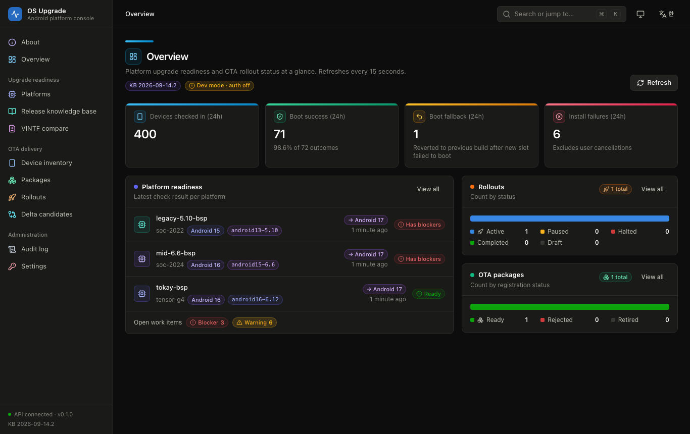
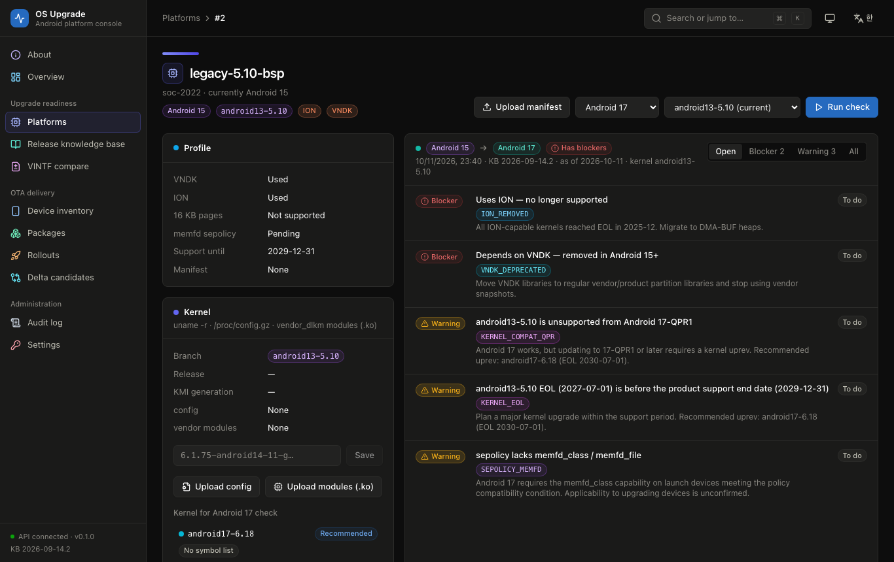
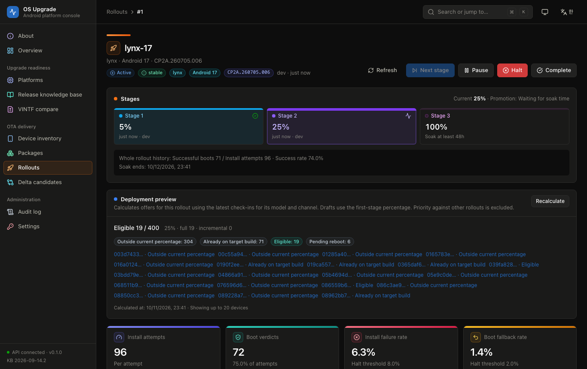

# android-os — Android OS upgrade backend (groundwork)
<p><a href="README.md" lang="ko">한국어</a> · <strong lang="en">English</strong></p>

**Research, design and core logic** for a backend that supports major OS upgrades (e.g. 16 → 17) of Android devices/BSPs.

- **Upgrade Readiness** — compares a platform profile (kernel branch, VNDK/ION, HALs, …) against the target release and reports blockers/warnings
- **OTA Delivery** — registers signed A/B OTA packages, matches update-checks, runs staged rollouts, collects telemetry and halts automatically

> Read [docs/design/00-scope-assumptions.md](docs/design/00-scope-assumptions.md) (Korean) first for scope, assumptions and open questions.

## Quick start

```sh
python3 -m venv .venv && .venv/bin/pip install -r requirements-server.txt
cd web && npm ci && npm run build && cd ..                                            # builds web/dist
ANDROID_OS_DEV_MODE=1 .venv/bin/uvicorn --factory backend.app:create_app --port 8020   # http://127.0.0.1:8020
.venv/bin/python scripts/seed_demo.py                                                  # (dev mode only) demo data
```

## Screens

| | |
|---|---|
|  |  |
| Overview — 24h check-ins, boot success/fallback and install failures, latest verdict per platform, rollout and package status | Platform readiness — blockers/warnings and work items for `legacy-5.10-bsp` evaluated against Android 17, with a recommended kernel uprev |
|  | |
| Rollout detail — stages (5% → 25% → 100%) and soak wait, deployment preview, install attempts, boot verdicts, failure rates and auto-halt thresholds | |

Demo data is 400 simulated devices plus a public Pixel OTA package, loaded by `scripts/seed_demo.py`.

## Documents

All documents below are in Korean.

| Document | Contents |
|---|---|
| [research/01 Platform upgrade requirements](docs/research/01-platform-upgrade-requirements.md) | Releases and API levels, GKI kernel matrix/EOL, Treble·VNDK·FCM, CTS, BSP checklist |
| [research/02 OTA delivery mechanics](docs/research/02-ota-delivery-mechanics.md) | A/B·VABC, payload/metadata, UpdateEngine API, security and rollback, implications for server design |
| [research/03 Similar OTA services](docs/research/03-similar-ota-services.md) | Comparison of GitHub projects and official docs: device inventory, tag targeting, target preview, promotion gates |
| [design/01 Requirements](docs/design/01-requirements.md) | Functional (RD-*, OT-*) and non-functional requirements |
| [design/02 Architecture](docs/design/02-architecture.md) | Components, sequences, ADRs |
| [design/03 Data model](docs/design/03-data-model.md) · [schema.sql](docs/design/schema.sql) | Entities, invariants, DDL |
| [design/04 API spec](docs/design/04-api-spec.md) | `/device/v1`, `/admin/v1` contracts |
| [design/05 Implementation plan](docs/design/05-implementation-plan.md) | Phases (P0–P5), risks |

## Core (`upgrade_core`, standard library only)

| Module | Function |
|---|---|
| `ota_package` | OTA zip → payload offset/size, `payload_properties`, metadata (pre/post build, timestamp, SPL, flags), reject reasons |
| `matcher` | device state × rollout → incremental first / full fallback; blocks timestamp and SPL downgrades |
| `rollout` | stable hash buckets, native ErrorCode decomposition, boot success/fallback verdicts, halt evaluation |
| `readiness` | rule-based verdicts from `data/releases.json` (kernel, FCM level, ION, VNDK, memfd, HAL, 16 KB pages) |
| `vintf` | parses device manifest (+fragments) and framework matrix, matrix diff, manifest × matrix check |
| `remote` | HTTP Range remote file — inspects multi-GB OTA zips by reading only a few hundred KB |
| `kernel` | parses GKI `uname -r` and kernel `.config` (.gz), analyses vendor `.ko` ELF files, compares against the KMI symbol list, proposes kernel uprev candidates |
| `drivers` | driver inventory — classifies kernel drivers (.ko: imported API, alias bus) and HALs by subsystem, ION usage per driver |

```sh
python3 -m unittest discover -s tests -t .   # core only (Python ≥ 3.10)
python3 -m venv .venv && .venv/bin/pip install -r requirements-server.txt
.venv/bin/python -m unittest discover -s tests -t .                              # including the API
ANDROID_OS_NETWORK_TESTS=1 .venv/bin/python -m unittest tests.test_remote        # live check against a public Pixel OTA
```

## Web console (`web/`)

React + TypeScript + Tailwind operations console. It includes a service introduction page (`#/about` — the two pillars, usage flow, verdict rules, configuration, principles), an overview dashboard, platform readiness verdicts and work items, a release knowledge base (kernel support-period chart),
VINTF matrix comparison, OTA package registration and inspection, rollout stage operations (progress trend, error codes, auto-halt evaluation), delta candidates and an audit log.
The device inventory (`#/devices`) shows the latest build, security patch, check-ins and install history per device and manages operator tags.
When creating a rollout you can set tag filters and per-stage minimum boot successes / success rates; the detail view shows a deployment preview and the reasons a promotion is blocked.
It supports a command palette (⌘K), light/dark theme, a mobile menu, a table view for every chart and a **Korean/English UI** (the `EN/한` button in the top bar or Settings — the first visit follows the browser language).
Readiness findings store and return both `title`/`detail` (Korean) and `title_en`/`detail_en` (English); verdicts produced before English was introduced are Korean only.

```sh
cd web && npm ci && npm run build      # builds web/dist → served by the backend at / (index.html no-cache, hashed assets immutable)
ANDROID_OS_DEV_MODE=1 .venv/bin/uvicorn --factory backend.app:create_app --port 8020   # http://127.0.0.1:8020
.venv/bin/python scripts/seed_demo.py   # (dev mode only) real public OTA + AOSP matrix + simulated device data

cd web && npm run dev                  # dev server http://127.0.0.1:5190 (API proxied to 8020)
```

## Backend API (P1 Readiness)

```sh
ANDROID_OS_DEV_MODE=1 .venv/bin/uvicorn --factory backend.app:create_app --port 8020   # docs: http://127.0.0.1:8020/docs
.venv/bin/python scripts/import_matrices.py --release 17 --tag android-17.0.0_r1   # register an AOSP tag matrix

A=http://127.0.0.1:8020/admin/v1
curl -X POST $A/platforms -H 'content-type: application/json' \
  -d '{"name":"my-bsp","soc":"my-soc","android_version":"15","kernel_branch":"android14-6.1"}'
curl -X PUT  $A/platforms/1/manifest -F files=@vendor/etc/vintf/manifest.xml -F files=@fragment.xml
curl -X POST $A/platforms/1/readiness-runs -H 'content-type: application/json' -d '{"target_release":"17"}'
# Kernel: register symbol lists (AOSP) → upload uname/config/vendor modules → evaluate against the post-uprev baseline
.venv/bin/python scripts/import_symbol_lists.py --branch android17-6.18
curl -X PUT $A/platforms/1/kernel -F kernel_release="$(adb shell uname -r)" -F config=@config.gz \
  -F modules=@vendor_dlkm/lib/modules/foo.ko
curl "$A/platforms/1/kernel/uprev?target_release=17"
curl -X POST $A/platforms/1/readiness-runs -H 'content-type: application/json' \
  -d '{"target_release":"17","target_kernel_branch":"android17-6.18"}'
curl -X POST $A/packages/inspect -H 'content-type: application/json' -d '{"url":"https://.../ota.zip"}'
```

## Backend API (P2–P4 OTA Delivery)

```sh
# Register a package (https origin with Range support) → rollout → device check
curl -X POST $A/packages -H 'content-type: application/json' -d '{"url":"https://dl.google.com/dl/android/aosp/lynx-ota-cp2a.260705.006-f4d6d546.zip"}'
curl -X POST $A/rollouts -H 'content-type: application/json' -d '{"name":"lynx-17","target_fingerprint":"google/lynx/lynx:17/CP2A.260705.006/15641320:user/release-keys","channel":"stable","stages":[{"percent":1,"min_soak_hours":24},{"percent":100}],"halt_rules":{"min_sample":200,"max_error_rate":0.03}}'
curl -X POST $A/rollouts/1/start
curl -X POST http://127.0.0.1:8020/device/v1/update-check -H 'content-type: application/json' \
  -d '{"device":"lynx","fingerprint":"google/lynx/lynx:16/BP4A.260205.001/14624666:user/release-keys","build_timestamp":1766287731,"security_patch":"2026-02-05","channel":"stable","device_hash":"<64 hex>"}'

# Real-device verification (userdebug + adb root)
python3 scripts/device_ota_test.py --api http://HOST:8020 --channel testing --apply
```

| Environment variable | Meaning |
|---|---|
| `ANDROID_OS_DB` | SQLite path (default `android_os.db`) |
| `ANDROID_OS_DEV_MODE` | `1` runs without auth or package-host restrictions (local development only). Otherwise the server refuses to start unless the keys/hosts below are set |
| `ANDROID_OS_DEVICE_KEYS` | shared keys for the device API |
| `ANDROID_OS_AUTO_HALT_INTERVAL_S` | auto-halt evaluation interval (default 300, 0 = disabled) |
| `ANDROID_OS_API_KEYS` | `key:actor:role,...` (role: admin/engineer/release_manager/operator/pipeline/viewer) |
| `ANDROID_OS_PACKAGE_HOSTS` | allowed hosts for `packages/inspect` (SSRF prevention, required in production) |

Progress and verification results: [design/05 §0.1](docs/design/05-implementation-plan.md) (Korean)

```python
from datetime import date
from upgrade_core.readiness import PlatformProfile, evaluate
evaluate(PlatformProfile("my-soc", "15", "android13-5.10", uses_ion=True), "17", date.today())

from upgrade_core.ota_package import inspect_ota_package
with open("pony-ota.zip", "rb") as f:
    info = inspect_ota_package(f)
print(info.ready, info.reject_reasons, info.payload_offset, info.apply_payload_headers())
```

The knowledge base (`upgrade_core/data/releases.json`) is current as of 2026-09-14 and every entry cites its source. When a new release appears (e.g. the final 17-QPR1, 26Q4), update this file together with `tests/test_readiness.py`.

## License

MIT — see [LICENSE](LICENSE).
