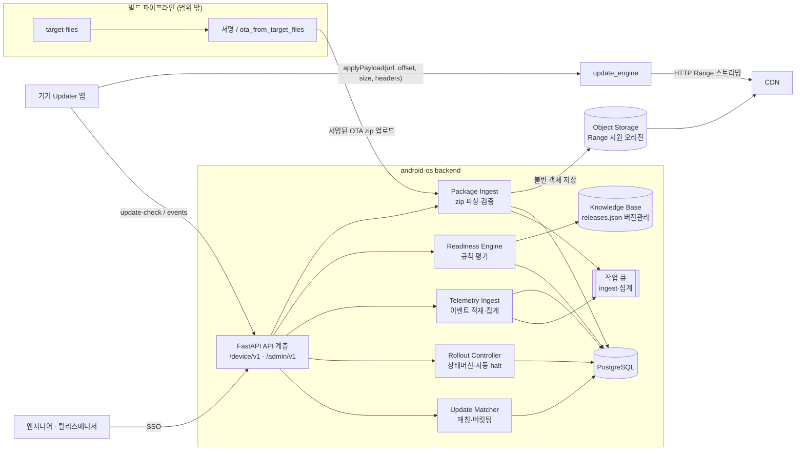
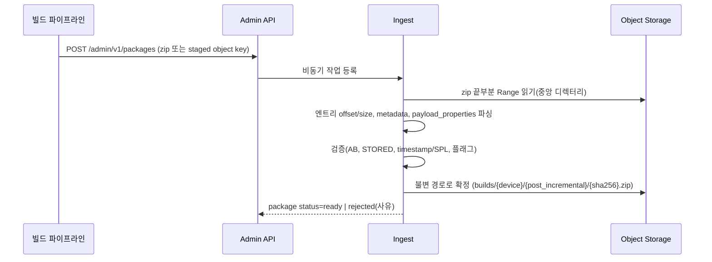
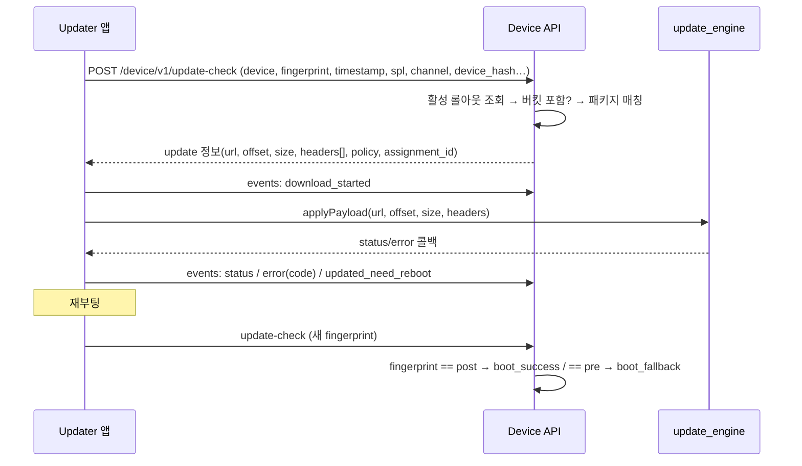

# 02. 아키텍처

## 1. 구성도

## 2. 컴포넌트 책임

| 컴포넌트 | 책임 | 코어 모듈(`upgrade_core`) |
|---|---|---|
| Package Ingest | zip 중앙 디렉터리만 읽어 엔트리 offset/size 계산, metadata·payload_properties 파싱, sha256, 검증 규칙(OT-02, OT-13) | `ota_package` |
| Update Matcher | 기기 요청 → 후보 패키지 → 규칙 필터 → incremental 우선 선택 → 응답 조립 | `matcher` |
| Rollout Controller | 상태 전이, 단계 비율, 안정적 해시 버킷, 임계값 평가 후 halt | `rollout` |
| Telemetry Ingest | 이벤트 검증·적재, native error code/플래그 분해, 부팅 성공/폴백 판정, 롤아웃별 집계 | `rollout`(판정), 집계는 SQL |
| Readiness Engine | 플랫폼 프로파일 × 목표 릴리스 → finding 목록 | `readiness` + `data/releases.json` |
| Knowledge Base | 릴리스·커널·FCM·CTS 사실과 출처·신뢰도. 코드와 함께 git 버전 관리, 판정 결과에 KB 버전 기록 | `data/releases.json` |

**설계 원칙**: 판단 로직은 I/O 없는 순수 함수(`upgrade_core`)로 두고, API/DB 계층은 얇게 유지한다. 인접 프로젝트(camera-hal-dev)와 같은 "표준 라이브러리 코어 + FastAPI" 구조.

## 3. 핵심 흐름

### 3.1 패키지 등록

### 3.2 업데이트 확인 → 설치 → 판정

### 3.3 자동 halt
집계 작업(예: 5분 주기)이 롤아웃별 `assigned / installed / error / fallback` 을 계산 → `rollout.halt_rules` 임계값과 비교 → 초과 시 상태 `halted`, 이후 update-check에서 해당 롤아웃은 **신규 할당하지 않음**(이미 할당·다운로드 중인 기기 처리 정책은 `halt_mode`: `stop_new` | `stop_all_pending`).

## 4. 배포 구조(초안)

| 계층 | 개발 | 운영(Q7 확정 후) |
|---|---|---|
| API | uvicorn 단일 프로세스 | 컨테이너 N개 + LB, device API와 admin API 분리 배포 권장 |
| DB | SQLite | PostgreSQL (events는 월 파티션) |
| 큐 | 인프로세스 스레드 | Redis/RQ 또는 Celery (선택 보류) |
| 객체 저장소 | 로컬 디렉터리 + Range 지원 정적 서버 | S3 호환 스토리지 + CDN |

## 5. 기술 결정 기록(ADR 요약)

| # | 결정 | 이유 | 대안 |
|---|---|---|---|
| D1 | 기기 프로토콜은 자체 JSON REST (Omaha 미사용) | Android update_engine은 Omaha 질의를 하지 않음. 응답을 applyPayload 인자에 맞추는 것이 가장 단순 | Omaha XML(스키마 참고만 함) |
| D2 | 패키지 메타데이터는 **서버가 zip에서 직접 파싱** | 수동 입력 오류가 곧 설치 실패(해시 불일치 등) | 파이프라인이 JSON 사이드카 제공 |
| D3 | 레거시 텍스트 metadata 우선 파싱, metadata.pb는 선택 | 표준 라이브러리만으로 처리 가능, 두 파일은 동일 정보 | protobuf 의존 추가 |
| D4 | 롤아웃 버킷 = `sha256(rollout_id:device_hash) mod 10000` | 비율 증가 시 기존 대상 유지, 롤아웃마다 독립 표본 | 기기 ID 고정 버킷(롤아웃 간 같은 기기가 항상 선두) |
| D5 | 롤백은 roll-forward만 지원 | timestamp/SPL/AVB rollback index로 다운그레이드 불가 | — |
| D6 | 지식베이스는 DB가 아닌 git 관리 JSON | 출처 리뷰·diff·재현성 | 관리 UI + DB |
