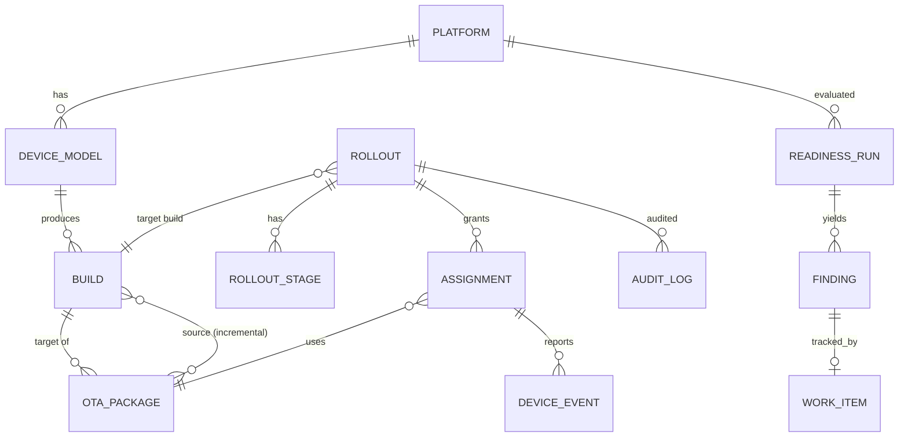

# 03. 데이터 모델

PostgreSQL 기준. 전체 DDL 초안은 [`schema.sql`](schema.sql).

## 1. ER 개요



## 2. 엔터티

### Readiness 도메인

| 테이블 | 주요 컬럼 | 비고 |
|---|---|---|
| `platform` | id, soc, name, android_version, first_api_level, board_api_level, board_api_frozen, kernel_branch(`android16-6.12`), fcm_target_level, page_size_kb, uses_vndk, uses_ion, sepolicy_memfd_ready | 프로파일 1건 = 1개 SoC/BSP 기준선 |
| `platform_hal` | platform_id, name(`android.hardware.camera.provider`), transport(hidl/aidl), version | RD-02, RD-07 |
| `device_model` | id, platform_id, device(`ro.product.device`), marketing_name, skus[] | |
| `readiness_run` | id, platform_id, target_release(`17`), kb_version, created_at, summary(jsonb) | NF-08 재현성 |
| `finding` | id, run_id, rule_id, severity(blocker/warning/info), title, detail, evidence(jsonb), source_urls[] | |
| `work_item` | id, finding_id, status, owner, waive_reason, external_ref(Jira key) | RD-05 |

### OTA 도메인

| 테이블 | 주요 컬럼 | 비고 |
|---|---|---|
| `build` | id, device_model_id, fingerprint(unique), incremental, timestamp_utc, spl(date), sdk_level, android_release | `ro.build.*` 값 |
| `ota_package` | id, target_build_id, type(full/incremental), pre_builds text[], pre_device text[], post_timestamp, post_spl, post_sdk_level, wipe, downgrade, spl_downgrade, object_key, url, file_size, sha256, payload_offset, payload_size, payload_properties(jsonb: FILE_HASH…), streaming_property_files(text), status(pending/ready/rejected/retired), reject_reasons[] | 인덱스: GIN(pre_builds), (target_build_id, type) |
| `rollout` | id, name, target_build_id, channel, filters(jsonb: carriers/regions/skus/source_fingerprints), state, current_percent, halt_rules(jsonb), halt_mode, policy(jsonb: require_unmetered, min_battery, install_window), created_by | OT-06, OT-07 |
| `rollout_stage` | rollout_id, seq, percent, min_soak_hours, promoted_at, promoted_by | 승격 이력 |
| `assignment` | id, rollout_id, device_hash, package_id, source_fingerprint, state(offered/downloading/installed_pending_reboot/boot_success/boot_fallback/failed), last_error_code, updated_at | unique(rollout_id, device_hash) |
| `device_event` | id, assignment_id?, device_hash, type, update_status, error_code_raw(int64), error_code_base, error_flags[], fingerprint, occurred_at, received_at, payload(jsonb) | 월 파티션, 보존기간 정책(NF-07) |
| `rollout_metrics_snapshot` | rollout_id, window_end, offered, installing, installed, boot_success, boot_fallback, errors_by_code(jsonb) | 자동 halt 입력 |
| `audit_log` | id, actor, action, entity, entity_id, before(jsonb), after(jsonb), at | NF-06 |

## 3. 핵심 불변식(애플리케이션/DB 제약으로 보장)

1. `ota_package.status='ready'` 인 행의 `object_key`, `sha256`, `payload_properties` 는 변경 불가(트리거로 차단) — NF-02.
2. `type='incremental'` ⇒ `cardinality(pre_builds) ≥ 1`.
3. 롤아웃에 편입되는 패키지는 `downgrade=false` 이고 `post_timestamp > source build timestamp` — OT-13 (예외는 audit_log에 승인 기록).
4. `assignment` 는 (rollout, device_hash)당 1개 — 버킷 결정은 결정적이므로 재요청 시 같은 결과.
5. `device_event.error_code_raw` 는 원형 그대로 저장, base/flags는 파생 컬럼 — OT-08.

## 4. Knowledge Base 스키마 (`upgrade_core/data/releases.json`)

```jsonc
{
  "kb_version": "2026-09-14",
  "releases": [
    { "release": "17", "api_level": 37, "fcm_level": "202604", "fcm_level_confidence": "unverified",
      "supported_kernels": ["android17-6.18", "..."],
      "kernels_dropped_from_qpr": {"android12-5.10": "17-QPR1"},
      "sources": ["https://source.android.com/..."] }
  ],
  "kernel_branches": [ { "branch": "android17-6.18", "launch": "2025-11-30", "eol": "2030-07-01" } ]
}
```
신뢰도 값: `primary`(Google 공식) / `secondary`(언론·커뮤니티) / `unverified`. 판정 규칙은 `unverified` 사실에 근거한 finding의 severity를 한 단계 낮추고 표시한다.
